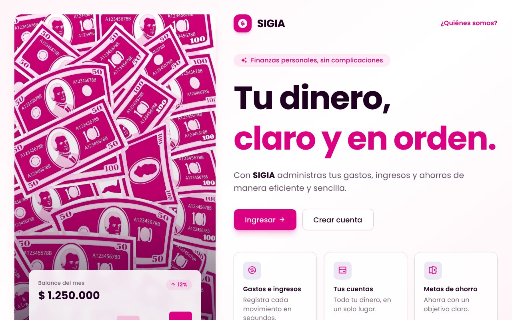
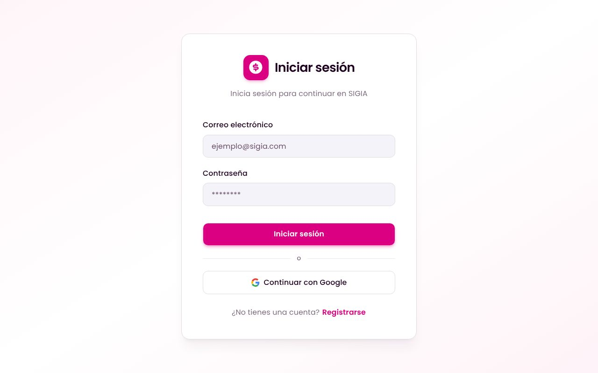
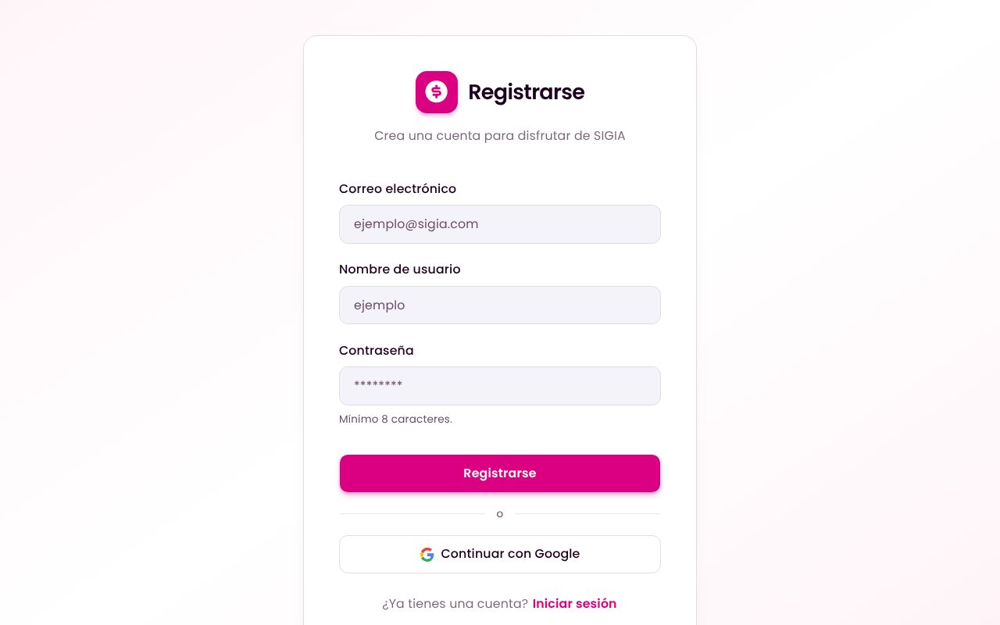
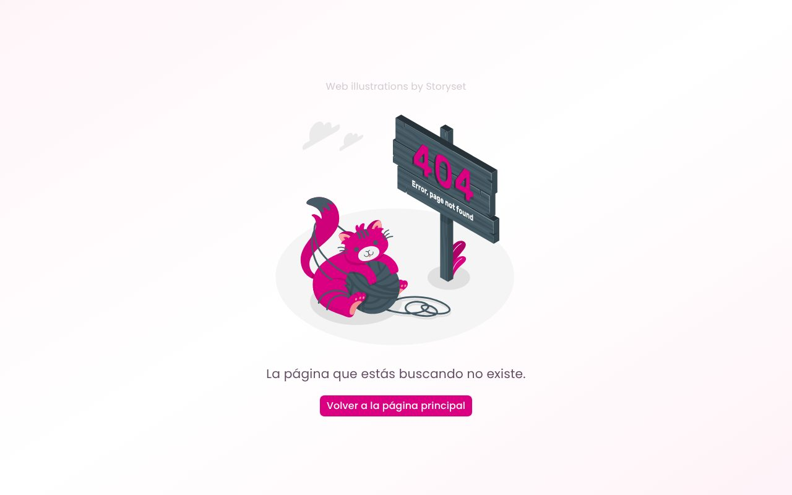

# Manual de usuario · SIGIA

SIGIA te ayuda a registrar tus gastos e ingresos, ver cuánto pesan en tus finanzas y descubrir cuánto ahorras cuando dejas de hacer un gasto habitual.

## Conceptos clave

| Término | Qué significa |
|---|---|
| **Concepto** | Un gasto o ingreso que se repite, por ejemplo "Café", "Arriendo" o "Salario". Tiene una frecuencia |
| **Movimiento** | Cada vez que registras un concepto, con su fecha, valor y cuenta |
| **Frecuencia** | Eventual, diaria, semanal, mensual o anual. Define en qué checklist aparece el gasto |
| **Cuenta** | Dónde está tu dinero. Todos empiezan con **Bolsillo** |
| **Checklist** | Lista de tus gastos habituales de un periodo. Lo que **no** marcas cuenta como **ahorrado** |

---

## 1. Entrar a SIGIA

- **Crear cuenta:** correo, nombre de usuario y contraseña de **al menos 8 caracteres**. Al registrarte se crea tu cuenta **Bolsillo**.
- **Ingresar:** con correo y contraseña, o con **Continuar con Google**. Si abriste un enlace a una página privada sin haber iniciado sesión, después de ingresar vuelves a esa página.
- **¿Quiénes somos?** muestra al equipo que creó SIGIA.

| Iniciar sesión | Registrarse |
|---|---|
|  |  |

Si escribes mal tus datos, aparece un aviso en español arriba a la derecha. Para salir, usa el botón **Cerrar sesión** del menú lateral.

## 2. Menú lateral

| Opción | Para qué sirve |
|---|---|
| **Inicio** | Checklist de gastos y resumen de gastos frente a ingresos |
| **Gastos** / **Ingresos** | Tus conceptos, filtros y registro de movimientos |
| **Cuentas** | Saldo y evolución de cada cuenta |
| **Ahorros** | Cuánto has ahorrado y tus metas |
| **Etiquetas** | Tus grupos personalizados |

## 3. Registrar un gasto o ingreso

1. Ve a **Gastos** (o **Ingresos**) y pulsa **Nuevo gasto**.
2. **Para repetir algo que ya registraste:** elígelo en *Reutilizar gasto*. Se rellenan el nombre, el último valor, la frecuencia y los grupos; solo cambia lo que necesites.
3. **Para un gasto nuevo:** escribe nombre y valor (mayor a 0) y elige la **frecuencia**, que es obligatoria.
4. Elige la **cuenta** (por defecto, Bolsillo) y la **fecha** (por defecto, hoy).
5. Opcional: marca uno o varios **grupos**.
6. Pulsa **Guardar movimiento**.

## 4. Consultar tus gastos

### Listado y filtros
Cada card muestra el **último valor**, la **frecuencia**, los **grupos** y la **fecha del último gasto**.

Puedes combinar cuatro filtros:
- **Nombre:** no importan las mayúsculas ni las tildes ("cafe" encuentra "Café").
- **Fecha:** desde y hasta, ambos días incluidos.
- **Etiqueta:** una frecuencia o un grupo.
- **Valor:** mínimo y máximo.

Un gasto aparece si **alguno de sus movimientos** cumple a la vez la fecha y el valor. Usa **Limpiar filtros** para volver a ver todo. Los filtros se conservan si recargas la página.

### Detalle de un gasto
Al abrir una card verás:
- **% de tus ingresos este mes:** cuánto de lo que ganaste este mes se fue en este gasto.
- **Gasto anual proyectado:** el último valor multiplicado por las veces que ocurre en un año. Para los eventuales, lo que llevas gastado en el año.
- **Ahorro si no lo repites:** lo que dejarías de gastar en un año.
- **Gráficas:** el gasto frente a tus gastos del mes y frente a tus ingresos del mes.
- **Historial:** se puede ordenar por **Fecha** o **Valor**. Pulsa de nuevo para invertir el orden.

Desde el historial puedes **editar** o **eliminar** un movimiento. Para borrar se pide confirmación.

## 5. Etiquetas y grupos

1. En **Etiquetas**, escribe el nombre del grupo (por ejemplo "Mascotas").
2. Elige el **color**: verde (positivo), neutro o rojo (alerta).
3. Elige un **ícono**; es obligatorio.
4. Pulsa **Crear grupo**.

Al eliminar un grupo, tus movimientos no se borran: solo pierden esa etiqueta.

## 6. Cuentas

- En **Cuentas**, escribe el **Nombre de la cuenta** y pulsa **Crear cuenta**. No puede repetirse ni pasar de 40 caracteres.
- **Bolsillo** no se puede eliminar. Las demás cuentas se eliminan con **Eliminar cuenta**, previa confirmación.
- Al abrir una cuenta verás:
  - el **saldo actual** (ingresos − gastos registrados en esa cuenta);
  - la **evolución del saldo** en el tiempo, si hay al menos 2 movimientos;
  - la **comparación** con ayer, hace una semana, hace un mes y hace un año, con su porcentaje de variación;
  - la lista de movimientos de la cuenta.

## 7. Checklist de gastos (Inicio)

La checklist te ayuda a llevar la cuenta de tus gastos habituales y a ver cuánto ahorras cuando no los haces.

1. Elige la frecuencia: **Diarios**, **Semanales**, **Mensuales** o **Anuales**.
2. Usa **Periodo anterior** para ir a un periodo que **ya terminó**. El periodo en curso no se puede guardar: la checklist de hoy se cierra mañana.
3. **Marca** los gastos que sí hiciste. Los que ya registraste a mano en ese periodo aparecen marcados y no se pueden desmarcar.
4. Elige la cuenta donde se registrarán los gastos marcados.
5. Pulsa **Guardar checklist** y confirma.

Al guardar:
- Cada gasto marcado se registra como movimiento real.
- Cada gasto **sin marcar** cuenta como **ahorrado**, por su último valor.
- **Cada periodo se guarda una sola vez y no se puede modificar.** Revísalo antes de confirmar.

## 8. Ahorros y metas

### Mis ahorros
- Cuatro totales: **Diario, Semanal, Mensual y Anual**.
- Un **desglose** por gasto: cuánto ahorraste y cuántas veces lo evitaste.
- Puedes consultar años anteriores.

### Metas de ahorro
1. En **Nueva meta de ahorro**, escribe el nombre, el monto objetivo y la fecha límite, y pulsa **Crear meta**.
2. Usa **Asignar ahorro** para pasar ahorro disponible a la meta y pulsa **Confirmar aporte**. No puedes asignar más de lo disponible ni más de lo que le falta a la meta.
3. Si te equivocaste, usa **Devolver ahorro** y luego **Confirmar devolución**.

Cada meta muestra una barra de progreso y su estado:
- **Pendiente:** aún no llega al monto objetivo y está en plazo.
- **Completada:** al llegar al 100 % aparece una felicitación.
- **Vencida:** pasó la fecha límite sin alcanzar el objetivo. Ya no admite aportes.

> El ahorro asignado a una meta es una forma de organizarte: **no mueve dinero entre tus cuentas.**

## 9. Gastos frente a ingresos (Inicio)

- Por defecto muestra **los últimos 6 meses**. Cambia el **Rango de fechas** con *Fecha de inicio* y *Fecha de fin* (máximo 24 meses).
- Muestra los gastos frente a los ingresos de cada mes y del total, con el porcentaje de tus ingresos que se fue en gastos.
- Si no hay movimientos en el rango, te invita a registrar el primero.

## 10. Mensajes frecuentes

| Mensaje | Qué hacer |
|---|---|
| "No hay conexión. Revisa tu internet e inténtalo de nuevo." | Verifica tu conexión y reintenta |
| "Tu sesión expiró. Inicia sesión de nuevo." | Vuelve a ingresar |
| "No tienes permiso para ver o modificar esta información." | Verifica que hayas ingresado con tu propia cuenta |
| "Algo salió mal de nuestro lado. Inténtalo en unos minutos." | Espera un momento y reintenta |
| "La contraseña debe tener al menos 8 caracteres" | Usa una contraseña más larga |
| "No puedes guardar la checklist hasta que termine el periodo." | Vuelve cuando el periodo haya terminado |
| "No tienes suficiente ahorro disponible." | Asigna un monto menor o espera a ahorrar más |
| "No puedes asignar ahorros a una meta vencida." | Crea una meta nueva con otra fecha |
| Una página que no existe | Verás la página 404 con un botón para volver |

